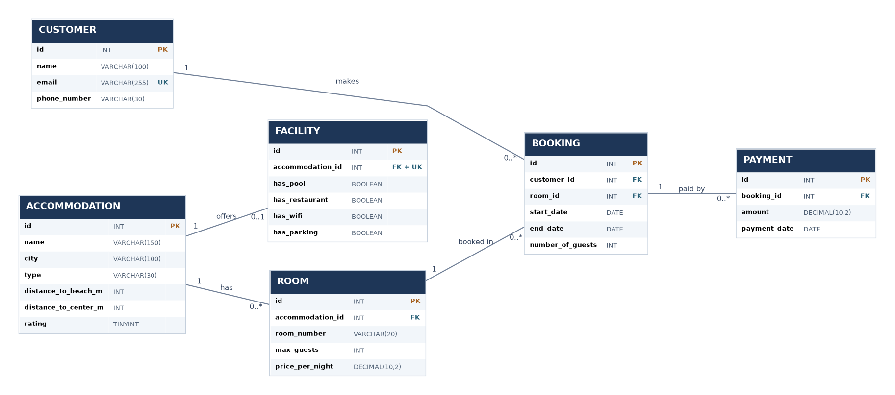

# Holiday Maker 🏨

Holiday Maker är ett bokningssystem som jag har utvecklat i C# och MySQL som en del av min utbildning till mjukvaruutvecklare med AI-inriktning.

Programmet är gjort för en operatör som ska kunna registrera kunder, söka efter lediga rum och hantera bokningar.

## Funktioner

Programmet har följande funktioner:

1. Visa boenden
2. Registrera kund
3. Söka lediga rum
4. Skapa bokning
5. Visa kundens bokningar
6. Ändra antal gäster
7. Avboka bokning

### Söka lediga rum

Användaren kan söka efter rum utifrån:

- Ort
- Incheckningsdatum och utcheckningsdatum
- Antal gäster
- Pool och restaurang
- Maxavstånd till strand och centrum

Sökresultaten kan sorteras efter lägsta pris eller högsta betyg.

Bokningsperioden är begränsad till december 2026.

### Bokningar

Vid en bokning kontrollerar programmet att:

- Kunden finns registrerad.
- Rummet finns.
- Antalet gäster inte överstiger rummets kapacitet.
- Rummet är ledigt under den valda perioden.
- Utcheckningsdatumet är senare än incheckningsdatumet.

Programmet beräknar även det totala priset för bokningen.

Ett rum kan bokas av en ny kund samma dag som den tidigare kunden checkar ut.

### Felhantering

Jag har lagt in felhantering för att programmet ska vara enklare att använda.

- Tomma obligatoriska fält accepteras inte.
- Felaktiga nummer och datum ger felmeddelanden.
- Användaren kan försöka igen vid felaktig inmatning.
- Man kan skriva `0` för att avbryta och gå tillbaka till huvudmenyn.
- Programmet visar meddelanden om databasen inte kan nås.

## Tekniker

Projektet använder:

- C# och .NET
- MySQL
- Docker
- DataGrip
- MySqlConnector
- Visual Studio Code
- Git och GitHub

## Databas

Databasen heter `holiday_maker` och innehåller sex tabeller:

| Tabell | Beskrivning |
|---|---|
| customer | Lagrar kunduppgifter |
| accommodation | Lagrar information om boenden |
| facility | Lagrar boendenas faciliteter |
| room | Lagrar rum och priser |
| booking | Lagrar bokningar |
| payment | Lagrar betalningsinformation |

Databasen använder primärnycklar (PK) och främmande nycklar (FK) för att koppla ihop tabellerna.

Jag har även använt begränsningar som `NOT NULL`, `UNIQUE` och `CHECK` för att skydda databasens innehåll.

### ER-diagram

Diagrammet visar hur tabellerna hör ihop, deras datatyper och relationerna mellan dem.



## Projektstruktur

```text
HolidayMaker/
├── Models/
├── Repositories/
├── UI/
│   ├── Screens/
│   └── ConsoleMenu.cs
├── Docs/
│   ├── ER-diagram.png
│   └── Manuella-tester.md
├── holiday_maker.sql
├── Program.cs
├── HolidayMaker.csproj
└── README.md
```

## Installation och start

### 1. MySQL och Docker

Se till att Docker är startat och att en MySQL-server körs.

Importera databasen från:

`holiday_maker.sql`

SQL-filen innehåller databasens tabeller och testdata.

### 2. Databasanslutning

Programmet behöver en anslutningssträng till MySQL.

Kontrollera att databasnamn, användarnamn, lösenord och port stämmer med din egen MySQL-miljö.

Lösenord ska inte läggas upp på GitHub.

### 3. Starta programmet

Öppna projektet i Visual Studio Code.

Kör följande kommandon i terminalen:

```bash
dotnet restore
dotnet build
dotnet run
```

Programmet visar sedan huvudmenyn där operatören kan välja funktion.

## Manuella tester

För att kontrollera att Holiday Maker fungerar används manuella tester av bokningssystemets viktigaste funktioner.

Testerna omfattar bland annat:

- Att lediga rum visas och upptagna rum filtreras bort.
- Att ett rum kan bokas samma dag som en annan kund checkar ut.
- Att överlappande bokningar nekas, även när en bokning omsluter en annan.
- Att rummets kapacitet inte kan överskridas.
- Att kombinerade sökfilter och båda sorteringsalternativen fungerar.
- Att ändring av antal gäster följer rummets kapacitet.
- Att avbokade rum blir tillgängliga igen.
- Att bokningar finns kvar efter att programmet har startats om.

Testernas genomförande och resultat dokumenteras i en separat fil.

[Se dokumentation för manuella tester](Docs/Manuella-tester.md)

## Säkerhet

Jag använder parametriserade SQL-frågor för att minska risken för SQL-injektion.

Programmet kontrollerar också användarens inmatningar innan uppgifter skickas vidare till databasen.

Vid bokningar kontrolleras tillgänglighet och antal gäster för att förhindra felaktiga bokningar.

## Begränsningar och framtida förbättringar

Bokningssystemet är för närvarande begränsat till december 2026.

Framtida förbättringar skulle kunna vara:

- Möjlighet att boka under hela året.
- Mer avancerad felhantering.
- Inloggning och behörigheter för operatörer.
- Möjlighet att ändra fler uppgifter i befintliga bokningar.
- Ytterligare automatiserade tester.

## Sammanfattning

Med Holiday Maker har jag arbetat med att koppla samman C# och MySQL i ett fungerande bokningssystem.

Jag har fått arbeta med databasdesign, relationer, SQL-frågor, felhantering och hur man bygger upp ett program med tydlig ansvarsfördelning mellan olika klasser.